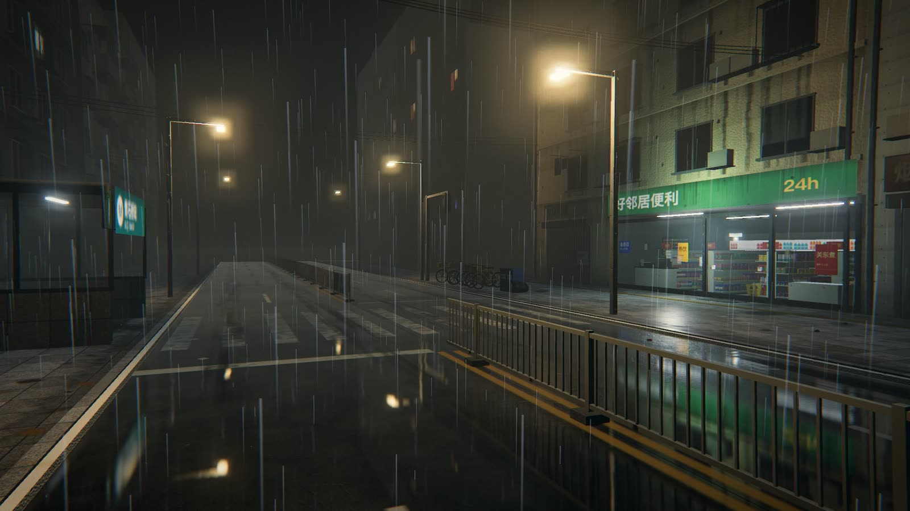
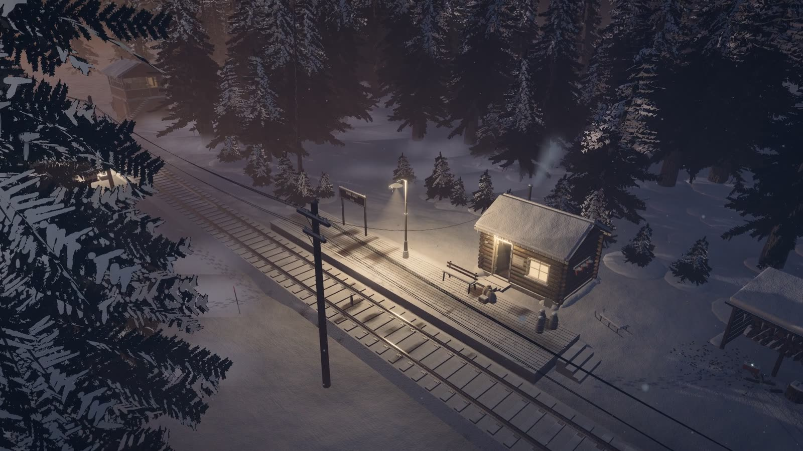
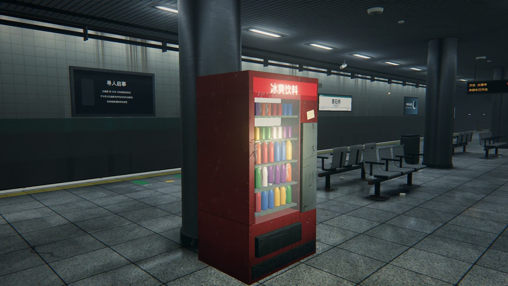

# World Forge · let an AI polish a 3D world on its own

[中文](README.md)



**Describe a place in one sentence. The agent builds its own tools, takes screenshots, finds the worst flaw, fixes it, and repeats for hours, then hands you a playable 3D scene** in one self-contained HTML file. Every model, texture and sound is generated in code: no asset packs, no modelling software.

> Inspired by Saltline, a browser game Claude built from a short prompt. This skill reproduces the working method behind it, with the harness and a parts library ready-made. It is an independent community project, not affiliated with Anthropic or with Saltline's author.

## Made with it

| Pine Halt | Night Metro + Street |
|---|---|
|  |  |
| A snowy forest halt at night: log hut, signal cabin, level crossing, an abandoned wagon, a freight train running in. | A metro station after the last train, then a rainy street outside. |
| **[▶ Play in the browser](https://zhuqipaopao-maker.github.io/world-forge/pine-halt/)** | **[▶ Play in the browser](https://zhuqipaopao-maker.github.io/world-forge/night-metro/)** |

Desktop only: click to start, WASD to move, mouse to look, Shift to run, E to interact.

## How it works
1. **Decide the look first**: a one-page brief, then the art bible (light, palette, fog, scale) in code.
2. **Build the eyes first**: a harness that shoots any view and reports errors, luma and frame times.
3. **Loop on the worst visible flaw** for hours. Every so often a fresh critic model that has never seen the code scores the sheets **blind** (it does not know which is newer), so the builder cannot flatter itself.

It ships with a tested parts library: HDR renderer, material library with wet and snow states, procedural trees and terrain, rain and snow, synthesised audio, and the screenshot and critic tools.

## Where it runs
It needs **shell access on your machine**, **file access**, and **eyes** (a model that can read images).

| Agent | Status |
|---|---|
| **Claude Code** | ✅ tested; both demos were made with it |
| **Codex** | 🟡 adapted; give the project full access (npm and Chrome need it) |
| **Other coding agents** | 🟡 should work; with a text-only model (e.g. DeepSeek) configure `critic.mjs` with a vision API |
| claude.ai web / mobile | ❌ no long-running local server or Chrome |

Results depend heavily on the model and on how long it is allowed to polish.

## Install
Requires Node.js 18+ and Google Chrome. Tested on macOS; Linux should work; on Windows use WSL (untested).

**Claude Code**
```
/plugin marketplace add zhuqipaopao-maker/world-forge
/plugin install world-forge@world-forge
```
or `git clone https://github.com/zhuqipaopao-maker/world-forge.git && cp -R world-forge/skills/world-forge ~/.claude/skills/`

**Codex**: `cp -R world-forge/skills/world-forge ~/.codex/skills/`, and run with full access.

**Others**: put `skills/world-forge` where your agent loads skills, or tell it to read `skills/world-forge/SKILL.md` first.

## Use
> Use world-forge to make a rainy old street late at night with one lit corner shop.

Tips: one scene polished for a long time beats several new scenes (about 1 h reaches indie quality; 6-8 h approaches AAA screenshots). Long runs use a lot of quota. Hard surfaces, interiors, night and weather work best; large natural landscapes are the weak spot.

## The critic (`tools/critic.mjs`)
Blind scoring by a separate model, via `CRITIC_CLI=claude|codex` or any OpenAI-compatible vision API (`CRITIC_API_KEY`, `CRITIC_BASE_URL`, `CRITIC_MODEL`; `CRITIC_PROVIDER=anthropic` for the Anthropic API). Required when your own model cannot read images.
```bash
node tools/critic.mjs score shots/012/_sheet.png
node tools/critic.mjs ab shots/011/_sheet.png shots/012/_sheet.png
node tools/critic.mjs cal shots/012/_sheet.png
```

## Credits and licence
MIT ([LICENSE](LICENSE)). Built on [three.js](https://threejs.org) (MIT). A few photo textures in the demos are CC0 from [ambientCG](https://ambientcg.com) and [Poly Haven](https://polyhaven.com). The method is inspired by Saltline; the skill contains descriptions of its techniques, not its code or assets.
