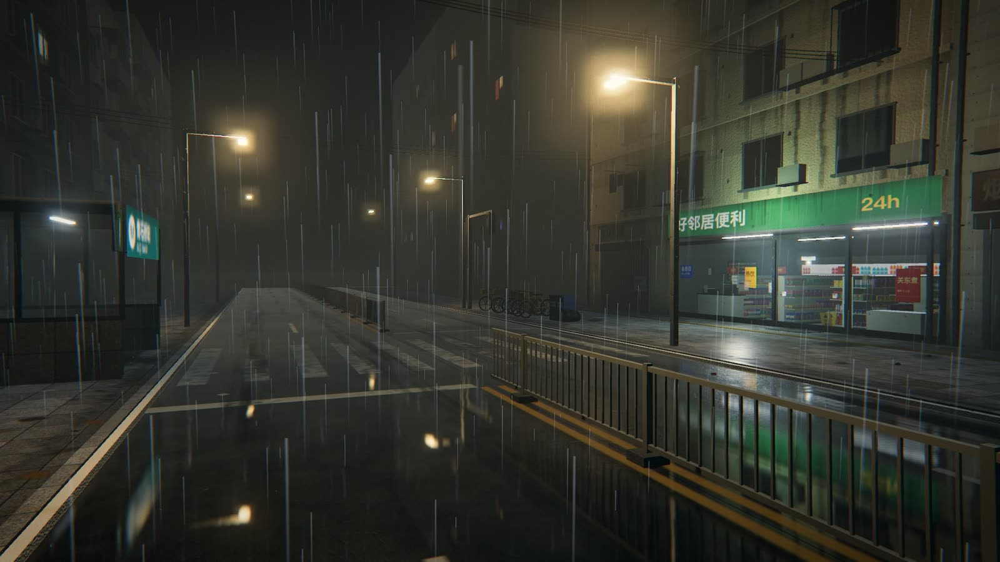
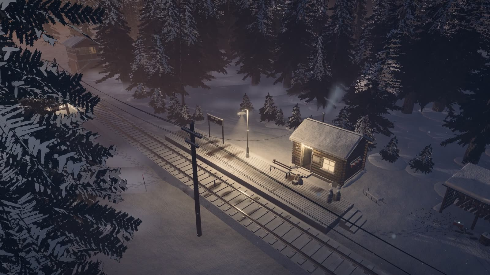
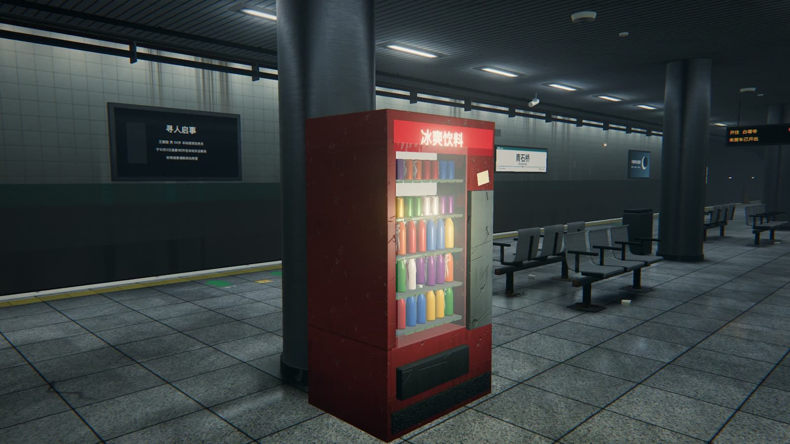
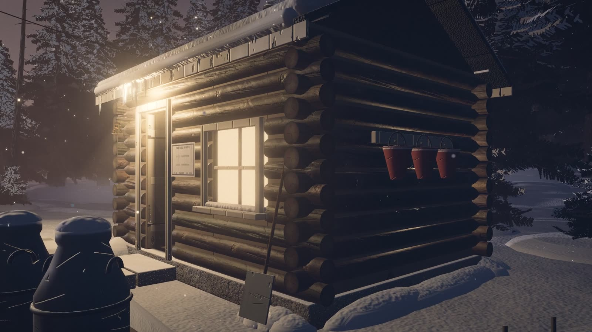
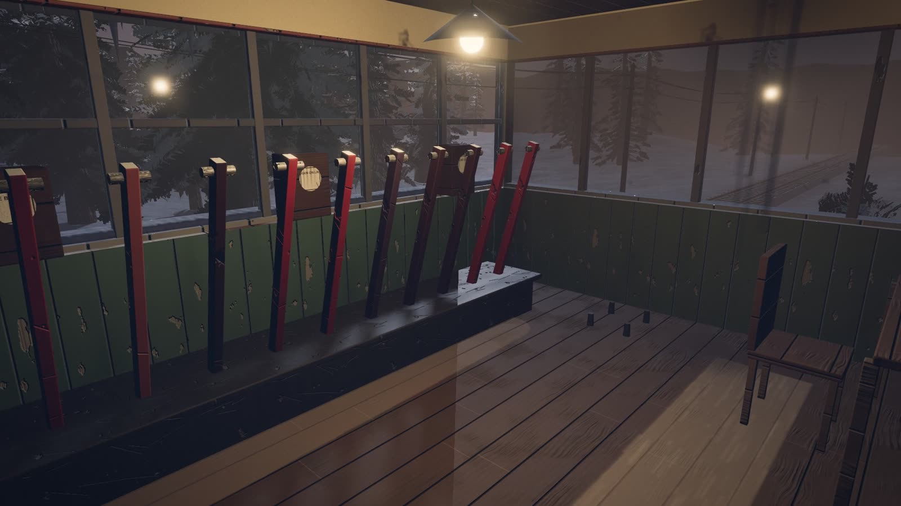
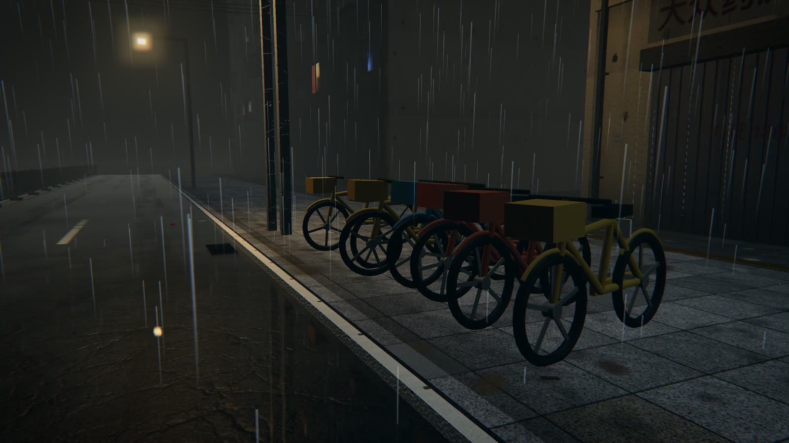
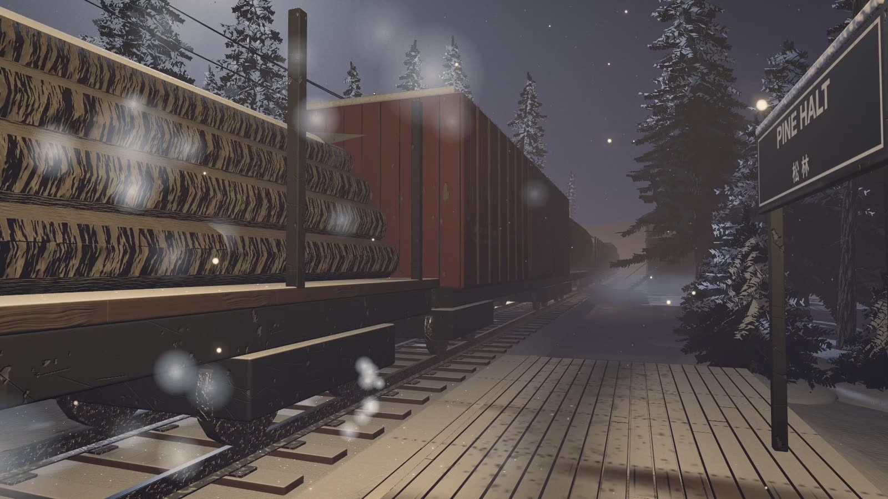
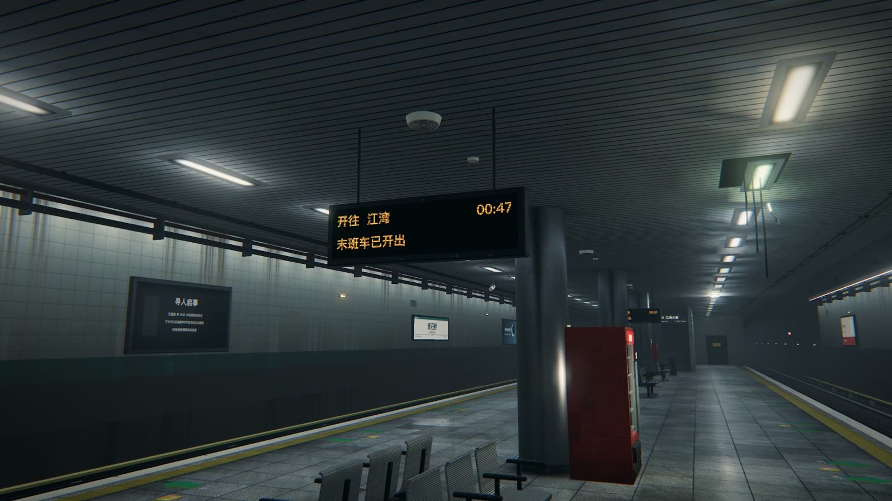

# World Forge · 让 AI 自己打磨出一个 3D 世界

[English](README.en.md)



**一句话描述一个地方，AI 自己搭工具、自己截图、自己找毛病、自己修，连续打磨几个小时，最后交给你一个可以玩的 3D 场景。** 场景是一个独立的 HTML 文件，双击就能玩。

所有模型、贴图、声音都是代码生成的，没有素材包，没有建模软件。

> 灵感来自 Saltline：一个由 Claude 根据一句简短提示做出来的浏览器游戏。本 skill 复现了它背后的工作方法，并配好了现成的工具和零件库。这是一个独立的社区项目，和 Anthropic、和 Saltline 的作者都没有关系。

## 用它做出来的场景

两个场景都是用这个 skill 做的，可以直接在浏览器里玩（需要电脑，用键盘和鼠标操作）：

| 松林小站 | 地铁与街道 |
|---|---|
|  |  |
| 雪夜林间的小车站。原木小屋、信号楼、道口、废弃车厢，还有一列进站的货车。 | 末班车后的地铁站，出站后是一条下着雨的街。 |
| **[▶ 在线试玩](https://zhuqipaopao-maker.github.io/world-forge/pine-halt/)** | **[▶ 在线试玩](https://zhuqipaopao-maker.github.io/world-forge/night-metro/)** |



| | |
|---|---|
|  |  |
|  |  |

操作方式：点击画面开始，WASD 走路，鼠标看，Shift 跑，E 互动。

## 它是怎么做到的

画面质量主要不靠聪明的代码，而靠三个习惯：

1. **先定画风，再动手**：写一页简报，再把光线、色调、雾、比例写进代码。
2. **先造眼睛**：先搭好截图工具。任何视角都能一键截图，同时读出报错、亮度和帧率。
3. **盯着最差的地方循环**：截图，找出最假的一处，修好，再截图，重复几个小时。每隔一段时间，换一个没看过代码的"评委"模型来**盲评打分**（不告诉它哪张是新版），用来防止 AI 自我感觉良好。

skill 自带一套测试过的零件：HDR 渲染器、带雨雪和湿润效果的材质库、程序化树木和地形、雨雪粒子、合成音效、截图和评分工具。

## 能在哪些工具里用

这个 skill 就是普通的文件加命令行，需要三样东西：**能在你电脑上执行命令**、**能读文件**、**能看图**。

| 工具 | 状态 |
|---|---|
| **Claude Code** | ✅ 实测。上面两个场景都是用它做的 |
| **Codex** | 🟡 已适配。需要给项目开"完全访问"权限 |
| **其他能执行命令的 AI 编程工具** | 🟡 理论上可用。模型看不了图的话（比如 DeepSeek），需要给评委脚本配一个能看图的 API，见下文 |
| claude.ai 网页版、手机 App | ❌ 不能用：没法长时间运行本地服务器和 Chrome |

**效果和模型强相关。** 上面两个场景是 Claude 连续打磨好几个小时做出来的。换成别的模型，可能会提前停，或者分数上不去。

## 安装

**环境**：Node.js 18 及以上，电脑上装了 Google Chrome。在 macOS 上测试过；Linux 应该可以；Windows 建议用 WSL（没测过）。

### Claude Code

在 Claude Code 里输入：
```
/plugin marketplace add zhuqipaopao-maker/world-forge
/plugin install world-forge@world-forge
```
或者手动安装：
```bash
git clone https://github.com/zhuqipaopao-maker/world-forge.git
cp -R world-forge/skills/world-forge ~/.claude/skills/
```

### Codex

```bash
git clone https://github.com/zhuqipaopao-maker/world-forge.git
cp -R world-forge/skills/world-forge ~/.codex/skills/
```
Codex 默认的沙盒会挡住 `npm install` 和 Chrome，所以要给这个项目开**完全访问**权限，或者在它请求时手动批准。

### 其他工具

把 `skills/world-forge` 文件夹放到工具读取 skill 的目录。如果这个工具不认 skill，就直接对它说："先读 `skills/world-forge/SKILL.md`，然后照着做"。

## 怎么用

对 AI 说一句话就行，比如：

> 用 world-forge 做一个下雨的深夜老街，有一家亮着灯的小卖部。

它会先问你两三个问题：打算花多少时间、中间要不要停下来给你看、项目放在哪里。然后就开始自己干活。

几点建议：
- **一个场景，磨得久，比做好几个场景效果好得多。** 1 小时大概能到"独立游戏"的水准，打磨 6 到 8 小时才接近 3A 截图的水准。
- **非常耗额度。** 长时间运行建议用 Claude Max 这类大额度套餐。
- **建筑、室内、夜景、雨雪这类硬表面最出效果。** 大片森林草地是这套方法的弱项。
- 内存小于 16 GB 的电脑，长时间运行时注意不要同时开太多东西。

## 评委脚本：给看不了图的模型配一双"眼睛"

`tools/critic.mjs` 会把截图发给另一个模型做盲评。它有两个用处：
1. 你用的工具没有"子代理"功能时，用它当评委；
2. **你用的模型看不了图片时（比如 DeepSeek），必须配置它**，否则 AI 等于闭着眼睛打磨。

支持任意 OpenAI 兼容的看图接口，配置三个环境变量即可。以下示例里的模型名请以各家文档为准：

```bash
# 通义千问 VL（阿里云百炼）
export CRITIC_API_KEY=你的key
export CRITIC_BASE_URL=https://dashscope.aliyuncs.com/compatible-mode/v1
export CRITIC_MODEL=qwen-vl-max

# 智谱 GLM-4V
export CRITIC_BASE_URL=https://open.bigmodel.cn/api/paas/v4
export CRITIC_MODEL=glm-4v-plus

# 也可以直接调用命令行工具，开一个独立进程当评委
export CRITIC_CLI=claude    # 或者 codex
```
用法（AI 会自己调用，你只需要配好环境变量）：
```bash
node tools/critic.mjs score shots/012/_sheet.png          # 打分并列出最大的 3 个问题
node tools/critic.mjs ab shots/011/_sheet.png shots/012/_sheet.png   # 新旧版本盲评对比
node tools/critic.mjs cal shots/012/_sheet.png             # 和参考作品盲评校准
```

## 致谢与许可

- 代码采用 MIT 许可，见 [LICENSE](LICENSE)。
- 基于 [three.js](https://threejs.org)（MIT）。
- 演示场景里少量照片纹理来自 [ambientCG](https://ambientcg.com) 和 [Poly Haven](https://polyhaven.com)，均为 CC0 授权。
- 工作方法的灵感来自 Saltline。skill 里只有对其技术的描述，没有它的代码和素材。
